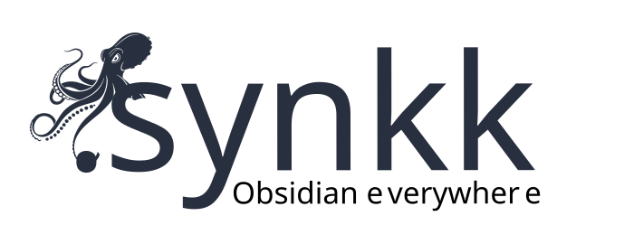
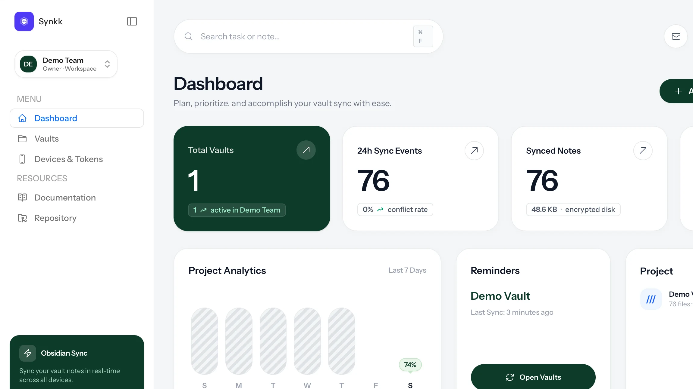
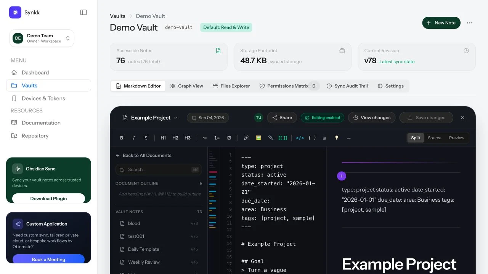
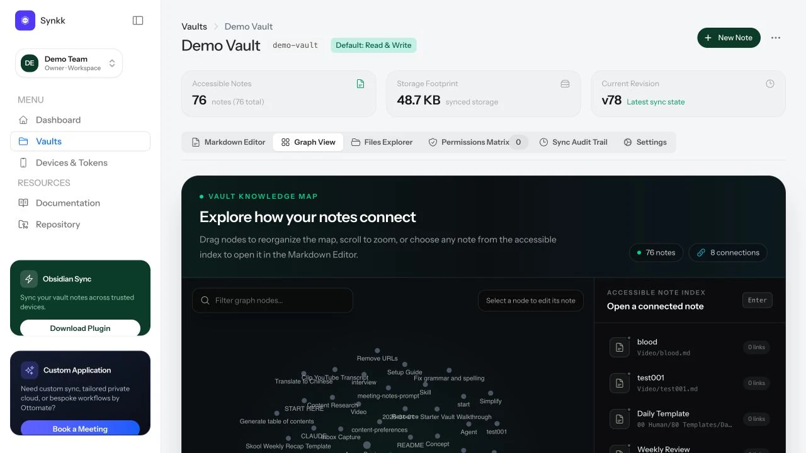
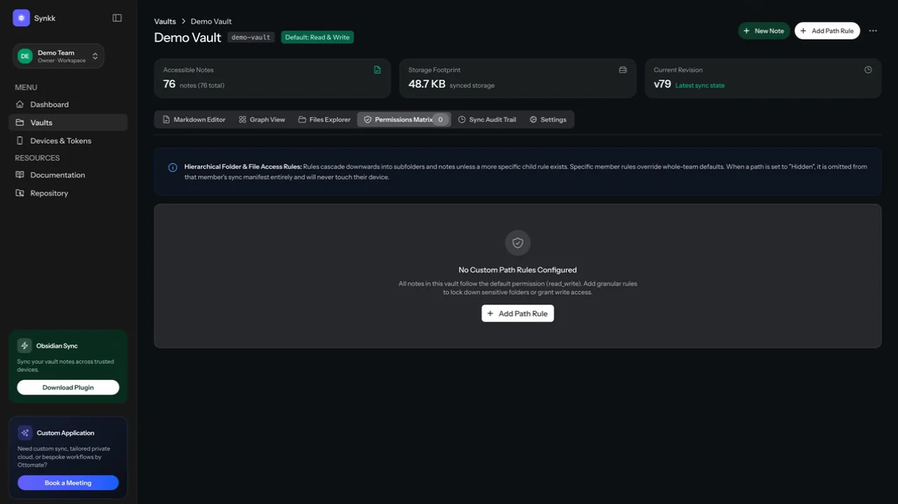

# Synkk Team Vault Sync

<p align="center">
  
</p>

<p align="center">
  <strong>Whole-file team vault sync, Vault AI Sidebar &amp; Proposal Inbox, Local E2EE AI, opt-in Yjs multiplayer, and zero-knowledge E2EE for Obsidian (`v1.1.1`, Desktop &amp; Mobile).</strong>
</p>

<p align="center">
  <a href="https://synkk.space">Website</a> ·
  <a href="https://obsidian.md/plugins?id=synkk-sync">Install from Obsidian</a> ·
  <a href="https://synkk.space/p/synkk-docs">Live Docs Portal</a> ·
  <a href="https://synkk.space/documentation">Docs</a> ·
  <a href="https://github.com/tawandajosephmutsena/synkk">Server repo</a> ·
  <a href="https://github.com/tawandajosephmutsena/synk-obsidian-plugin/releases/latest">Latest release</a> ·
  <a href="https://ottomate.space">Ottomate</a>
</p>



**Synkk Team Vault Sync** (`synkk-sync`, requires Obsidian `1.7.2+`) connects your desktop or mobile Obsidian vault to a self-hosted or Synkk Cloud server. It delivers private infrastructure, path-scoped team permissions, deterministic conflict recovery, opt-in real-time CRDT collaboration, client-side AES-256-GCM encryption, and an integrated AI Sidebar + Change Inbox without turning your team into Git operators.

## Product Screens

| Web Dashboard | Markdown Editor |
| --- | --- |
|  |  |

| Graph View | Permissions Matrix |
| --- | --- |
|  |  |

## Core Capabilities

- **Cross-Platform Sync (`isDesktopOnly: false`):** Full support for macOS, Windows, Linux, iOS, and Android with startup sync, file-change debouncing (2.5s), scheduled intervals (1–30 min), and an Adaptive Background Relay (60s heartbeat + mobile foreground wake-up).
- **One-Scan QR & Deep-Link Pairing:** Pair devices via camera QR scan, screenshot upload, clipboard paste, or `obsidian://synkk-pair` / `/pair` deep link using single-use 10-minute pairing sessions.
- **First-Sync Pre-Flight & Migration Wizard:** 4-step wizard that categorizes vault files, flags `.trash/`, `.git/`, and files >25 MB, auto-sanitizes illegal cross-platform characters (`: * ? " < > | \`), runs a zero-byte quota dry-run (`POST /api/v1/vaults/{slug}/preflight`), and arms the Atomic Safety Shield.
- **Atomic Safety Shield & Pre-Mutation Snapshots:** Client-side deletion circuit breaker (defaults to **10%**, configurable 1–100%) with one-time guarded override and automatic local backups in `.synkk/snapshots/` before remote overwrites or deletions.
- **Visual Conflict Sandbox & AI Smart Merge:** Concurrent offline edits never overwrite local files; conflicting remote versions are saved as `*.sync-conflict-<timestamp>.*` and reconciled side-by-side with **Keep Canonical**, **Keep Conflict**, **Combine Both**, or **Smart Merge with AI**.
- **Dockable Synkk AI Sidebar, Proposal Inbox & Vault Gardener:** Chat with your vault inside Obsidian, review proposed AI edits line-by-line in the **AI Change Inbox** before approving, or trigger **Vault Gardener** runs.
- **Zero-Knowledge E2EE & Local AI (Ollama / LM Studio):** Client-side WebCrypto **AES-256-GCM** encryption (`PBKDF2-SHA-256`, 100,000 iterations) with RAM-only passphrases (never saved to `data.json`). On E2EE vaults, server AI is disabled automatically and the AI Sidebar & Smart Merge route directly to your local Ollama (`http://localhost:11434`, e.g., `llama3.2`) or OpenAI-compatible server using local BM25 + 1-hop `[[wikilink]]` graph retrieval.
- **Opt-In Real-Time Multiplayer Collaboration (Yjs CRDT):** Toggle **Enable Real-Time Collaboration (CRDT)** in settings (disabled by default to prioritize atomic whole-file stability) for CodeMirror 6 live carets over Laravel Reverb, with AES-256-GCM + AAD encryption on E2EE vaults.
- **On-Demand Mobile Ghost Files:** Automatically stubs non-Markdown attachments above a configurable threshold (default **5 MB**, 2–50 MB) on mobile, with Command Palette commands to hydrate or dehydrate on demand.
- **Selective Sync & Plugin Suite Sync:** Per-device include/exclude folder prefixes plus optional `.obsidian/` plugin/theme/snippet syncing (with desktop-only plugin filtering on mobile and strict exclusion of Synkk credentials).

## Security & Architecture Disclosures

- **E2EE Vaults:** Note contents, binary attachments, and Yjs collaboration updates are encrypted strictly on-device with WebCrypto AES-256-GCM before leaving Obsidian. Passphrases remain in volatile memory only and must be re-entered after restarting Obsidian (no recovery key is stored on the server). File paths, sizes, and version numbers remain plaintext metadata for sync manifests and path ACLs. Server-side search, Portals, DLP scanning, MCP, and cloud AI are disabled on E2EE vaults.
- **Standard Vaults:** File contents travel over HTTPS so the server can enforce path ACLs, maintain 25-version rollback history, run plaintext DLP secret scanning, render Livewire Portals, and power opt-in Hybrid Search / Vault AI / Remote MCP.
- **Transport Security:** Remote pairing enforces HTTPS (`http:` is permitted only for `localhost`, `127.0.0.1`, `[::1]`, `*.test`, `*.local`, and RFC1918 LAN addresses).

## Installation & Quick Setup

### Method 1: Obsidian Community Plugins (Recommended)

1. In Obsidian (`1.7.2+`), open **Settings → Community plugins → Browse** (or open `obsidian://show-plugin?id=synkk-sync`).
2. Search for **Synkk Team Vault Sync**, click **Install**, and toggle it **On**.
3. In your Synkk web dashboard, go to **Devices → Pair Device** to generate a QR code or deep link.
4. In Obsidian **Settings → Synkk Vault Sync**, click **📷 Scan QR Code** (or paste the pairing URL into **One-Scan Quick Connect**).

### Method 2: Manual Installation (GitHub Releases)

1. Download `main.js`, `manifest.json`, and `styles.css` from the [latest release](https://github.com/tawandajosephmutsena/synk-obsidian-plugin/releases/latest).
2. Create `<vault>/.obsidian/plugins/synkk-sync/` and copy all three files into it.
3. In Obsidian, open **Settings → Community plugins** and enable **Synkk Team Vault Sync**.
4. In **Settings → Synkk Vault Sync**, pair via QR/deep link or enter your Server API URL ending in `/api/v1` and your `synkk_...` device token, click **Verify & Load Vaults**, and select your **Target Vault**.

## Development

```bash
npm ci
npm run build
npm test
```

The production build compiles TypeScript and bundles `main.js`. Release packages also include `manifest.json` and `styles.css`.

## Links

- Public app: [synkk.space](https://synkk.space)
- Documentation: [synkk.space/documentation](https://synkk.space/documentation)
- Live Docs Portal: [synkk.space/p/synkk-docs](https://synkk.space/p/synkk-docs)
- Server repo: [github.com/tawandajosephmutsena/synkk](https://github.com/tawandajosephmutsena/synkk)
- Plugin repo: [github.com/tawandajosephmutsena/synk-obsidian-plugin](https://github.com/tawandajosephmutsena/synk-obsidian-plugin)
- Security disclosures: [synkk.space/security](https://synkk.space/security) (`security@synkk.space`)

## Creators

Synkk is created by [Ottomate](https://ottomate.space). Product direction and engineering are led by [Tawanda Joseph Mutsena](https://github.com/tawandajosephmutsena).

## License

The plugin is licensed under the [MIT License](LICENSE).
